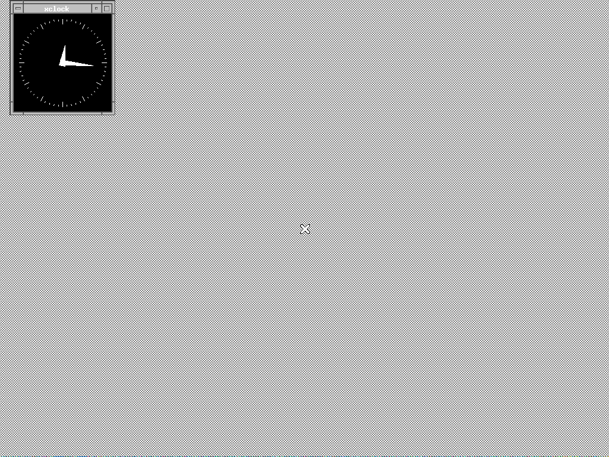
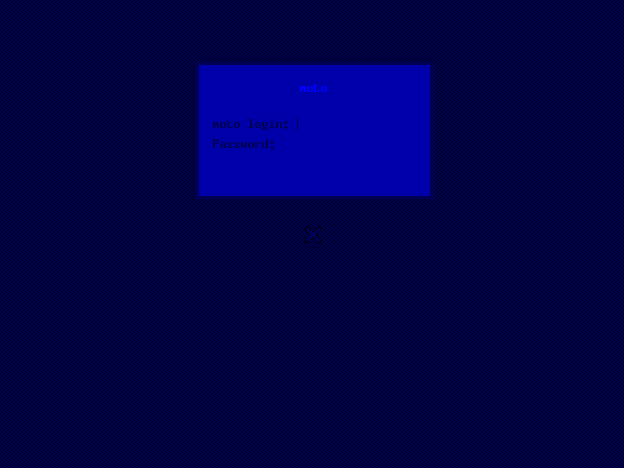
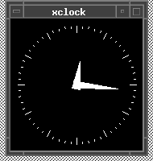

# Motorola MVME393 Hardware Support & X11 Server

Hardware support, driver source, distribution packages, and documentation for the **Motorola MVME393 VMEbus Color Graphics Controller** running on **Motorola System V/88 Release 4 (m88k SVR4)** and compatible VME single-board computers (MVME187, MVME188, MVME197).



---

## Highlights

* **Authentic SVR4 Datastream Package:** Ready-to-install `xcfb-1.0.0-m88k.pkg` installable via standard `pkgadd` without compiler or third-party dependencies.
* **Native X11R4 Color Framebuffer Server (`Xcfb`):** 1024 × 768 × 8-bit pseudocolor display engine with 256-color palette.
* **Dual Input Integration:** Supports both direct VME memory-mapped event injection (`0xfe000`) and the Motorola DeltaWINDOWS Dual-Port RAM hardware ring queue (`0xfd840000`).
* **Motif Window Manager (`mwm`) Verified:** Fully tested and verified running OSF/Motif window manager, `xclock`, and X11 client suites.
* **XDM Graphical Login Integration:** Includes automated scripts (`enable-xdm`, `disable-xdm`) supporting native SVR4 X Display Manager with MIT-MAGIC-COOKIE-1 authentication and automatic boot-time startup.

---

## Screenshots

| X11 Desktop (mwm + xclock) | XDM Graphical Login (`xdm`) | Analog Clock Detail |
| :---: | :---: | :---: |
|  |  |  |

---

## Repository Structure

```
hwsupport/sysv88k/mvme393/xcfb/
├── packages/                  # Ready-to-install binary distribution archives
│   ├── xcfb-1.0.0-m88k.pkg    # Official SVR4 datastream package (pkgadd)
│   ├── xcfb-1.0.0-m88k.tar.Z  # Standalone compressed tarball (install.sh)
│   └── checksums.txt          # Cryptographic checksums (MD5 & SHA256)
├── packaging/                 # SVR4 package definitions & installer scripts
│   ├── pkginfo                # Package metadata
│   ├── prototype              # Package prototype file
│   ├── postinstall            # Automated environment & device setup script
│   ├── preremove              # Clean uninstallation script
│   ├── startxcfb              # Desktop & X server launcher
│   ├── enable-xdm             # Script to enable XDM graphical login
│   ├── disable-xdm            # Script to disable XDM graphical login
│   └── install.sh             # Standalone shell installer
├── src/
│   ├── xcfb/                  # Complete X11R4 Xcfb source tree for m88k SVR4
│   │   ├── Makefile           # Standalone build Makefile
│   │   ├── xcfb/              # MVME393 DDX driver (screen, input, palette)
│   │   ├── cfb/               # Color framebuffer graphics routines
│   │   ├── mfb/               # Monochrome framebuffer routines
│   │   ├── mi/                # Machine-independent graphics & cursor sprite
│   │   ├── dix/               # Device-independent X server core
│   │   ├── os/                # SVR4 OS interface
│   │   └── include/           # Server headers
│   └── tools/
│       └── x393inject.c       # Mouse & keyboard injector utility
├── screenshots/               # Framebuffer captures and visual verifications
│   ├── x11_mouse_input_color.png
│   ├── x11_xdm_login.png
│   ├── x11_xdm_login_cropped.png
│   └── x11_xclock_window.png
└── docs/                      # Technical documentation
    ├── mvme393_hardware.md    # Hardware register & memory mapping reference
    ├── installation_guide.md  # Detailed installation walkthrough
    ├── xdm_setup.md           # XDM configuration & architecture details
    └── deltawindows_protocol.md# Firmware download & DPR queue protocol
```

---

## Quickstart: Installing the Package

### 1. Using SVR4 Package Manager (`pkgadd`) &mdash; Recommended
On your Motorola System V/88 system, run as root:

```sh
pkgadd -d packages/xcfb-1.0.0-m88k.pkg xcfb
```

The installer automatically creates `/dev/memregion/12` (`c 19 140`), prepares `/tmp/.X11-unix` with sticky permissions (`1777`), and links `/usr/bin/X11/X` to `/usr/bin/X11/Xcfb`.

Query package status:
```sh
pkginfo -l xcfb
```

### 2. Using Standalone Installer
```sh
zcat packages/xcfb-1.0.0-m88k.tar.Z | tar xvf -
cd xcfb-1.0.0-m88k && sh install.sh
```

To install and immediately enable XDM login in one step:
```sh
sh install.sh --enable-xdm
```

---

## Running X11

### Manual Desktop Session
To launch the X server together with the Motif Window Manager and desktop clock:

```sh
/usr/bin/X11/startxcfb
```

### Enabling XDM Graphical Login
To enable XDM to manage display `:0` and start graphical login automatically on boot:

```sh
/usr/bin/X11/enable-xdm
```

To revert back to standard console login:

```sh
/usr/bin/X11/disable-xdm
```

See [docs/xdm_setup.md](docs/xdm_setup.md) for full details on XDM configuration, MIT cookie authentication, and runlevel management.

---

## Building from Source

To build `Xcfb` natively on a Motorola System V/88 machine:

```sh
cd src/xcfb
make
```

The resulting `Xcfb` binary will be produced in the current directory.
