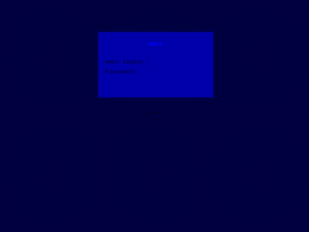

# XDM Graphical Login Configuration for MVME393

This document details how to configure and manage the **X Display Manager (XDM)** on **Motorola System V/88 Release 4 (m88k SVR4)** using the native `Xcfb` color framebuffer server.



---

## 1. Overview

Motorola System V/88 R40V4 ships with the standard X11R4 X Display Manager (`/usr/bin/X11/xdm`). However, by default, Motorola configured the system as a "fileserver for headless or X terminal environments" (`Xservers.fs`). As shipped, XDM does not manage any local display.

The `xcfb` package provides automated utilities (`enable-xdm` and `disable-xdm`) to convert your system into a full graphical workstation that boots directly into an XDM graphical login prompt.

---

## 2. Automated Configuration

The package installs two management scripts into `/usr/bin/X11/`:

### Enabling XDM
To enable graphical login on display `:0`:

```sh
# /usr/bin/X11/enable-xdm
```

This performs all necessary configuration steps:
1. Links `/usr/bin/X11/X` to `/usr/bin/X11/Xcfb`.
2. Configures `/usr/lib/X11/xdm/Xservers` to start `Xcfb` on `:0`.
3. Permits root graphical login by adjusting `/etc/default/login`.
4. Creates boot startup links in `/etc/rc3.d/S25xdm` and `/etc/rc2.d/K15xdm`.
5. Starts or restarts the active XDM daemon immediately.

### Disabling XDM
To disable graphical login and return to text-only console mode:

```sh
# /usr/bin/X11/disable-xdm
```

This stops the running XDM daemon, restores the original `/usr/lib/X11/xdm/Xservers` and `/etc/default/login` configuration, and removes the runlevel startup links.

---

## 3. Technical Implementation Details

### A. Display Server Registration (`Xservers`)
XDM reads `/usr/lib/X11/xdm/Xservers` to identify local and remote displays to manage. Motorola's shipped file only lists comments for NCD and Tektronix X terminals.

Adding the following line configures XDM to manage the local MVME393 display:
```
:0 local /usr/bin/X11/X :0
```

### B. Startup Handshake & SIGUSR1 Signaling
When XDM starts a local X server, it sets the signal handler for `SIGUSR1` to `SIG_IGN` in the child process.

The `Xcfb` server contains native handshake support in `os/connection.c`:
1. `Xcfb` checks if `SIGUSR1` was set to `SIG_IGN` at server entry.
2. Once initialization completes and the listening socket `/tmp/.X11-unix/X0` is bound, `Xcfb` executes `kill(ParentProcess, SIGUSR1)`.
3. Upon receiving `SIGUSR1`, XDM knows the server is ready to accept client connections and launches the greeter widget (`xdm -config ...`).

### C. MIT Magic Cookie Authentication
XDM generates a temporary authorization cookie file for each session (e.g. `/usr/lib/X11/xdm/A:0-a0005E`) and invokes `X` with the `-auth <file>` argument.

`Xcfb` natively supports `-auth` through `os/auth.c` and `os/utils.c`. It loads the cookie into the internal authorization database and validates connecting clients.

### D. Root Login Permissions (`/etc/default/login`)
Motorola SVR4 enforces console root restrictions via `/etc/default/login`:
```
CONSOLE=/dev/console
```
When this setting is active, the `/usr/lib/X11/xdm/Xsession` script checks the login device. Because XDM sessions run on pseudo-terminals (`/dev/pts/*`), root logins are blocked with the error:
```
Login as root disallowed
```
Commenting out this restriction (`#CONSOLE=/dev/console`) allows administrative login from the XDM greeter while preserving full security for normal accounts.

---

## 4. Runlevel Integration

Motorola SVR4 boots into Run Level 3 (multi-user mode with networking). The XDM daemon is managed via standard System V init scripts:

* **Init script:** `/etc/init.d/xdm`
* **Startup symlink:** `/etc/rc3.d/S25xdm -> /etc/init.d/xdm`
* **Shutdown symlink:** `/etc/rc2.d/K15xdm -> /etc/init.d/xdm`

On system reboot into init level 3, XDM starts automatically, launches `Xcfb`, and presents the login screen.
